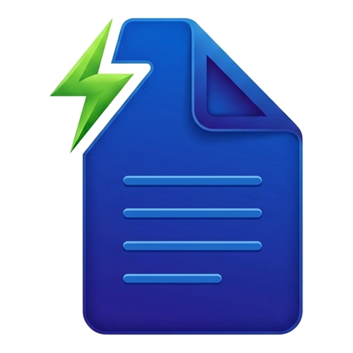
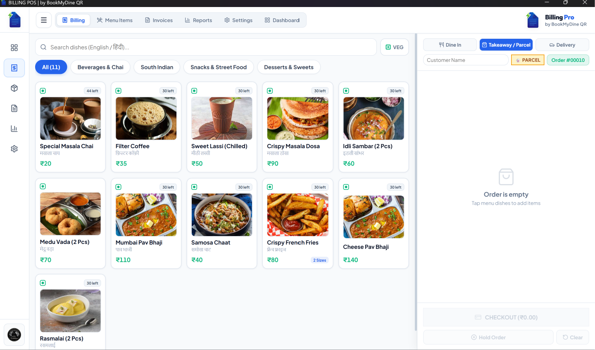
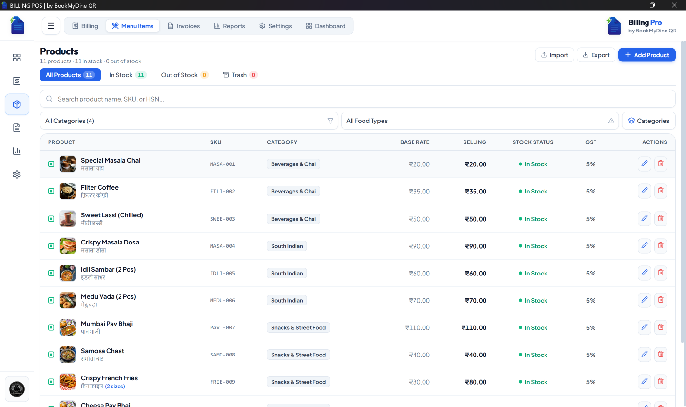
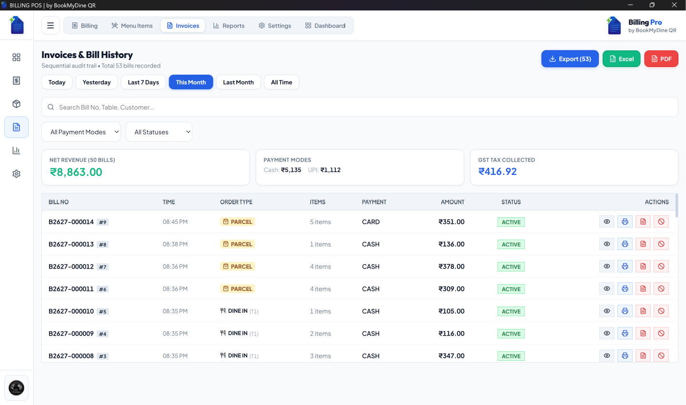
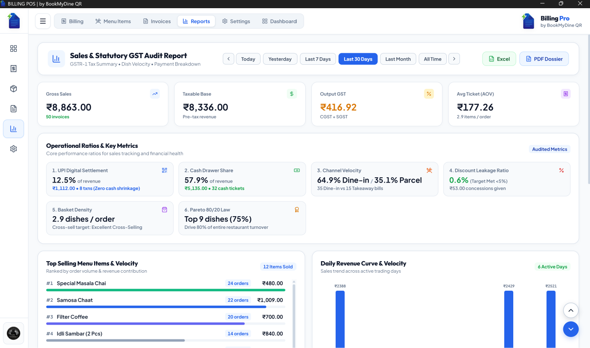
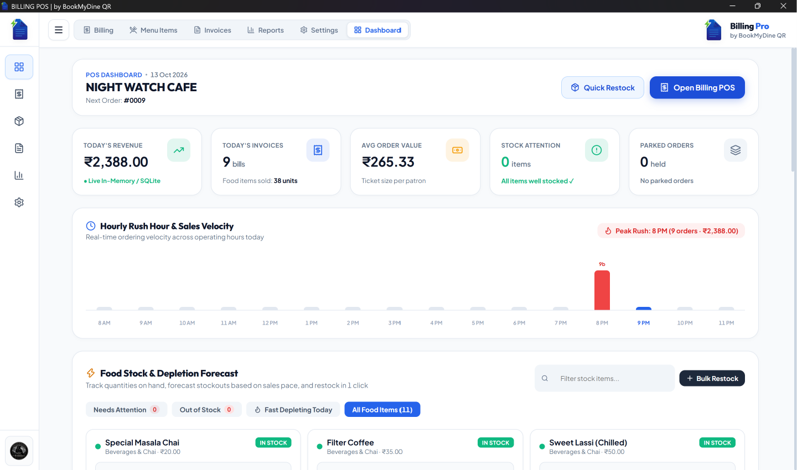
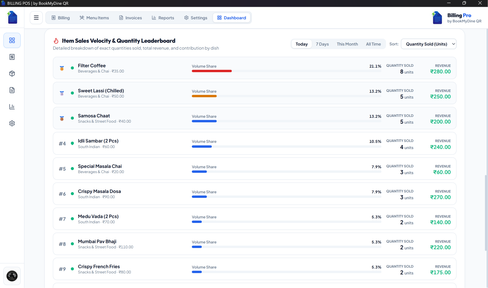

# Billing Pro POS ⚡
### Enterprise Offline-First POS, Thermal Receipt Billing & Business Intelligence Platform

<p align="center">
  
</p>

<p align="center">
  <b>100% Offline Point of Sale (POS) and invoicing powerhouse built for Restaurants, Cafés, QSRs, Cloud Kitchens, Food Trucks, and Retail Counters.</b><br>
  <i>Sub-10 second order punching, native ESC/POS Bluetooth & USB thermal printing, dynamic Bharat UPI QR generation, Dexie IndexedDB offline engine, Google Pay-style settlement animation, and audited financial reporting.</i>
</p>

<p align="center">
  <a href="https://github.com/Tusharjain-19/Billing-Pos/releases"></a>
  <a href="https://github.com/Tusharjain-19/Billing-Pos/releases"></a>
  <a href="https://github.com/Tusharjain-19/Billing-Pos/releases"></a>
</p>

<p align="center">
  <a href="https://react.dev/"></a>
  <a href="https://www.typescriptlang.org/"></a>
  <a href="https://electronjs.org/"></a>
  <a href="https://capacitorjs.com/"></a>
  <a href="https://dexie.org/"></a>
  <a href="LEGAL.md"></a>
  <a href="SECURITY.md"></a>
</p>

---

## 📂 Project Directory Structure

The repository is cleanly organized into 3 core production targets:

| Folder | Platform / Target | Description & Deliverables |
| :--- | :--- | :--- |
| ⚡ [**web app software/**](web%20app%20software/) | **Unified POS Software (Web & Desktop)** | Complete React 19 + TypeScript + Vite POS application source code, Electron Windows desktop runtime (`.exe` installer & `.zip` portable), Dexie IndexedDB engine, thermal drivers, and offline PWA assets. |
| 📱 [**app/**](app/) | **Android Mobile & Handheld POS** | Native Android production release (`.apk`), Capacitor 8 Android Gradle project, and handheld POS (Sunmi/iMin) configurations. |
| 🌐 [**website/**](website/) | **Marketing & Web Portal** | Public landing page, product showcases, thermal simulator, demo video player, and direct `.exe` / `.apk` download hub. |
| 🛠️ [**scripts/**](scripts/) | **Automation & Build Tools** | Asset generation, packaging scripts, and deployment utilities. |

---

## 📑 Repository Documentation Quick Links

| Document | Purpose & Description |
| :--- | :--- |
| 📖 [**USER_GUIDE.md**](USER_GUIDE.md) | **Step-by-Step Operator Manual**: Cashier workflows, 58mm/80mm Bluetooth printer setup, order holding, dynamic UPI QR settlements, and daily closing procedures. |
| ⚖️ [**LEGAL.md**](LEGAL.md) | **Commercial Licensing & IP Protection**: Commercial terms, ownership rights, anti-reverse engineering restrictions, and liability disclaimers. |
| 🛡️ [**SECURITY.md**](SECURITY.md) | **Security Architecture & Offline Privacy**: Air-gapped database sandboxing, terminal hardening, and zero cloud data leakage guarantees. |
| 📐 [**DESIGN.md**](DESIGN.md) | **Industrial UI/UX Architecture**: 0px border-radius standard, non-AI color system, native typography, and cash register ergonomics. |

---

## 📥 Direct Download & Release Packages

Download the latest production-ready packages for your device:

| Platform | Package Format | Direct Download Link | Description & Requirements |
| :--- | :--- | :--- | :--- |
| **Windows PC** | **Interactive Setup Wizard (.exe)** | [📥 **Download Billing_Pro_POS_Setup_v1.0.0.exe**](https://github.com/Tusharjain-19/Billing-Pos/releases/download/v1.0.0/Billing_Pro_POS_Setup_v1.0.0.exe) | **Recommended for Windows**: Guided NSIS installer with custom drive/directory selector, desktop shortcut generation, and clean uninstaller. |
| **Windows PC** | **Portable Standalone (.zip)** | [📥 **Download Billing_Pro_POS_v1.0_Windows_x64.zip**](https://github.com/Tusharjain-19/Billing-Pos/releases/download/v1.0.0/Billing_Pro_POS_v1.0_Windows_x64.zip) | **Zero Install**: Extract anywhere (SSD, HDD, or USB flash drive) and launch `Billing-Pro-POS.exe` immediately. |
| **Android Mobile & POS** | **Universal Android Package (.apk)** | [📥 **Download Billing_Pro_v1.0.apk**](https://github.com/Tusharjain-19/Billing-Pos/releases/download/v1.0.0/Billing_Pro_v1.0.apk) | Direct installable APK for Android phones, tablets, and handheld smart POS terminals (Android 7.0+ / API 24+). |

---

## 🎬 Product Demo Video

Watch Billing Pro POS in action — featuring high-speed order punching, instant category navigation, dynamic UPI QR settlement, and thermal receipt printing:

<div align="center">
  <video src="billing%20pos%20demo.mp4" controls="controls" muted="muted" style="max-width: 100%; border: 1.5px solid #D1D5DB; box-shadow: 0 16px 40px rgba(0,0,0,0.12);" width="860">
    <p>Your browser does not support HTML5 video. <a href="billing%20pos%20demo.mp4">Click here to download and view the demo video</a>.</p>
  </video>
  <br>
  <sub><i>Video: Live 1080p demonstration of cashier billing station, order fulfillment, and report generation in Light Mode.</i></sub>
</div>

---

## 📸 Real Software Screenshots & Interface Walkthrough

Billing Pro POS features 100% authentic, high-contrast industrial interfaces designed strictly according to [`DESIGN.md`](DESIGN.md):

### 1. Rapid Counter Billing Station & Live Cart Docket
Tap dishes across categorized touch matrices, select item modifiers, customize parcel packaging charges, and observe real-time CGST/SGST tax computations.

<p align="center">
  
</p>

---

### 2. Menu Items & Product Inventory Catalog
Manage dish base rates, selling prices, real-time stock decrement thresholds, GST tax slabs (0%, 5%, 12%, 18%), HSN codes, and bulk Excel imports/exports.

<p align="center">
  
</p>

---

### 3. Invoices Ledger & Sequential Audit Trail
Immutable sequential invoice records (`B2627-000001` through `B2627-000014`), payment mode breakdown (Cash, Card, Dynamic Bharat UPI), reprint triggers, and one-click Excel/PDF exports.

<p align="center">
  
</p>

---

### 4. Sales & Statutory GST Audit Report (GSTR-1 Ready)
Complete tax compliance with Gross Sales vs Output GST breakout, Taxable Base, Average Order Value (AOV), Operational Ratios, Pareto 80/20 law, and daily revenue curves.

<p align="center">
  
</p>

---

### 5. Executive POS Dashboard & Hourly Rush Hour Velocity
Real-time KPI overview featuring today's revenue, order counts, average ticket size, food stock depletion forecast, and hourly ordering rush histograms.

<p align="center">
  
</p>

---

### 6. Item Sales Velocity & Quantity Leaderboard
Deep-dive product performance ranking showing unit volume share, top revenue contributors, and menu engineering metrics.

<p align="center">
  
</p>

---

## 💡 Core Business Capabilities & Figures

Billing Pro POS provides real-world figures and workflows suited for high-volume retail and restaurant operations:
- **Cashier Billing Station**: Rapid billing with live menu items (Masala Chai ₹20, Paneer Tikka ₹180, Cold Coffee ₹70), live stock counters, order fulfillment selectors (Dine In / Takeaway / Delivery), custom discount inputs, and split payments.
- **Financial Analytics & Dashboard**: Clear sales insights—daily revenue, order volume, average ticket size, payment mode split (Cash, Bharat UPI QR, Card), top selling dishes, and peak rush hours.
- **Menu & Inventory Catalog**: Stock indicators, cost rates vs selling prices, GST tax slabs (0%, 5%, 12%, 18%), HSN codes, and bulk CSV/Excel import/export.
- **Invoices & Bill History**: Settled, held, and cancelled invoices with date range filters, reprint triggers, payment status, and GST compliance.
- **Mobile POS on Smartphones & Handhelds**: Dedicated layout with bottom navigation tabs, slide-up cart drawer, large tactile touch targets, and wireless Bluetooth printer connectivity.

---

## 🚀 Key Features & Architectural Highlights

### ⚡ Sub-10-Second High-Speed Billing
- **Tactile Touch Grid**: Designed with large touch targets ($48\text{px}$) for rapid counter punching during high-rush shifts.
- **Bilingual Menu Search**: Instant search indexing across English item names and Hindi transliterations.
- **Order Types**: Seamlessly toggle between **Dine In** (with Table numbers), **Takeaway / Parcel**, and **Delivery**.
- **Inventory Stock Boundaries**: Real-time stock decrement guard prevents selecting or punching more units than available inventory.
- **Held Bills / Parked Orders**: Park active carts with one tap to serve next customers and recall instantly.

### 📴 100% Air-Gapped Offline-First
- **Local Dexie.js (IndexedDB)**: 100% offline database engine with zero server latency and zero cloud dependency.
- **Complete Data Sovereignty**: All business records and customer transactions remain strictly on your local machine.
- **Automated Local Backups**: Generates automated `.json` database snapshots for quick disaster recovery and cross-device migration.

### 🖨️ Native ESC/POS Thermal Printing Engine
- **Bluetooth SPP & USB Direct**: High-speed wireless and wired printing for standard 58mm (2-inch, 384 dots) and 80mm (3-inch, 576 dots) thermal receipt printers.
- **Centered 58mm Logo Rasterization**: Specialized dithering algorithm centers your brand logo and outputs crisp 1-bit monochrome bitmaps without CORS clipping.
- **Itemized Tax & FSSAI Breakdown**: Prints GSTIN, FSSAI registration, itemized CGST/SGST, order fulfillment type, and custom receipt footers.

### 💳 Zero-Fee Dynamic UPI Bharat QR Settlement
- **Instant Client-Side QR Computation**: Generates dynamic UPI payment QR codes on screens and receipts containing merchant VPA and exact payable amount.
- **Zero MDR Fees**: Customers pay directly via PhonePe, Google Pay, Paytm, BHIM, or Cred straight into the merchant's bank account.
- **Google Pay-Style Animated Confirmation**: Displays a celebratory animated green checkmark modal with ripple waves upon bill settlement.

### 📊 Business Intelligence & Financial Dossier Exports
- **10 Indian Restaurant Specific Operational Ratios**: Table turnover velocity, average spend per guest, peak revenue hours, and food cost metrics.
- **Real Graphs in PDF Export**: Automatically embeds visual daily revenue charts, payment mode distribution donuts, and dish velocity graphs into exported PDF audit files.
- **Excel & PDF Exports**: One-click generation of `.xlsx` spreadsheets and formatted PDF audit summaries for accounts and CA tax filings.

---

## 🛠️ Technology Stack

| Layer | Technology | Version | Purpose |
| :--- | :--- | :--- | :--- |
| **Frontend Framework** | **React** | `19.2` | High-efficiency UI component architecture & fast state reconciliation |
| **Language** | **TypeScript** | `5.8` | End-to-end type safety across POS models, database transactions, and print drivers |
| **Build Pipeline** | **Vite** | `6.2` | Lightning-fast build bundling and Hot Module Replacement |
| **Desktop Shell** | **Electron** | `44.6` | 100% offline native desktop container with local file system & printer bridge |
| **Windows Packaging** | **NSIS / Electron Builder** | `26.15` | Multi-step interactive Windows installer with license consent & location picker |
| **Mobile Runtime** | **Capacitor JS** | `8.5` | Native Android bridge for Bluetooth SPP, Haptics & Filesystem |
| **Database Engine** | **Dexie.js** | `4.4` | High-performance IndexedDB engine for offline storage |
| **Spreadsheets** | **SheetJS (XLSX)** | `0.18` | In-browser Excel `.xlsx` report generator & menu importer |
| **Document Engine** | **jsPDF & AutoTable** | `4.2` | High-definition PDF invoice & settlement audit report generator |
| **Iconography** | **Lucide Icons** | `1.49` | Clean, high-legibility interface iconography |

---

## 💻 Developer Guide & Local Build

### 1. Clone & Install Dependencies
```bash
git clone https://github.com/Tusharjain-19/Billing-Pos.git
cd Billing-Pos
npm install
```

### 2. Run Local Web Dev Server
```bash
npm run dev
```
Open [http://localhost:5173](http://localhost:5173) in your browser.

### 3. Build Production Web Bundle
```bash
npm run build
```

### 4. Build Windows Desktop Setup Installer (.exe)
```bash
npm run dist:exe
```
Generates `release-pc/Billing_Pro_POS_Setup_v1.0.0.exe` with interactive NSIS installer.

### 5. Build Android Release APK
```powershell
npm run cap:sync
cd mobile/android
./gradlew assembleRelease
```

---

## 👨‍💻 About the Developer & Creator

<div align="center">
  <h3>Designed & Engineered by <b>Tushar Jain</b></h3>
  <p><i>Full-Stack Product Architect • Offline-First Systems • FinTech & POS Engineering</i></p>
  
  <p>
    <a href="https://tusharjain.in"></a>
    <a href="https://github.com/Tusharjain-19"></a>
  </p>
  
  <p style="max-width: 650px; color: #64748B; font-size: 13.5px; line-height: 1.6;">
    Building hyper-responsive, resilient point-of-sale solutions, air-gapped financial engines, and modern offline-first architectures that empower food, beverage, and retail entrepreneurs with lightning-fast business operations.
  </p>
</div>

---

## ⚖️ Legal & Copyright Notice

Copyright © 2026 **Billing Pro POS / BookMyDine QR**. All Rights Reserved Worldwide.  
This software and its compiled binaries are proprietary commercial products. For complete licensing terms, restrictions, and data protection policies, please refer to [**LEGAL.md**](LEGAL.md) and [**SECURITY.md**](SECURITY.md).

---

<p align="center">
  <b>Billing Pro POS</b> • Superfast • Reliable • 100% Offline • High Performance Point of Sale System<br>
  <sub>Crafted with passion by <a href="https://tusharjain.in">Tushar Jain</a></sub>
</p>
